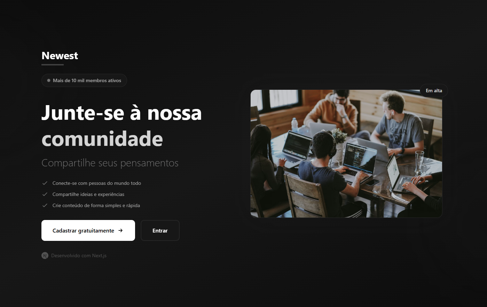

# 📰 Newest

Uma **rede social de publicações**, do banco de dados à tela: cadastro e login, posts com texto e imagens, curtidas, comentários, menções com `@usuario`, notificações, busca de pessoas e perfil com avatar e bio.

🌐 **Acesse:** [newest-app.vercel.app](https://newest-app.vercel.app)



---

## 📁 Como o repositório está organizado

Este é um **monorepo**: o back-end e o front-end vivem no mesmo repositório, cada um na sua pasta, com dependências próprias.

```
Newest/
├── Newest-BackEnd/    # 🧠 Back-end: NestJS + Prisma + PostgreSQL (rotas, regras, autenticação)
├── Newest-FrontEnd/   # 🎨 Front-end: Next.js + React (as telas que o usuário vê)
├── docs/              # 🖼️ Imagens usadas neste README
└── README.md          # 📍 Você está aqui
```

| Pasta | O que tem |
|---|---|
| [`Newest-BackEnd/`](./Newest-BackEnd) | Módulos de usuário, autenticação, posts, comentários e notificações; schema e migrations do Prisma |
| [`Newest-FrontEnd/`](./Newest-FrontEnd) | Páginas (feed, post, perfil, busca, notificações, configurações), componentes e serviços que chamam a API |

---

## 🔧 Funcionalidades

**Conta e perfil**
- Cadastro e login com JWT (senhas guardadas com hash bcrypt)
- Perfil com avatar, bio e lista de posts
- Edição dos dados e exclusão da própria conta
- Busca de usuários

**Publicações**
- Posts com título, texto e imagens (upload para o Cloudinary)
- Imagens verificadas pelo [Sightengine](https://sightengine.com/) antes de publicar (nudez e violência são barradas)
- Curtir e descurtir, com contador
- Comentários em cada post
- Menções com `@usuario` no post ou no comentário

**Notificações**
- Aviso quando alguém curte, comenta ou menciona você
- Contador de não lidas e "marcar todas como lidas"

---

## 🚀 Tecnologias Utilizadas

| Camada | Tecnologias |
|---|---|
| **Back-end** | [NestJS](https://nestjs.com/) · TypeScript · [Prisma](https://www.prisma.io/) · PostgreSQL · Passport + JWT · Zod (nestjs-zod) · Cloudinary · Sightengine |
| **Front-end** | [Next.js](https://nextjs.org/) · React · [Tailwind CSS](https://tailwindcss.com/) · shadcn/ui (Radix) · [TanStack Query](https://tanstack.com/query) · React Hook Form + Zod · Axios |
| **Hospedagem** | [Vercel](https://vercel.com/) (front) · [Render](https://render.com/) (API) |

---

## 🏗️ Como as partes conversam

```
  Navegador
     │  abre o site
     ▼
┌──────────────────┐  HTTPS + token JWT  ┌──────────────────┐       SQL       ┌──────────────┐
│ FrontEnd (Next)  │ ──────────────────▶ │  BackEnd (Nest)  │ ──────────────▶ │  PostgreSQL  │
│      Vercel      │ ◀────────────────── │      Render      │ ◀────────────── │              │
└──────────────────┘    respostas JSON   └──────────────────┘                 └──────────────┘
         │                                        │
         └──────── imagens ──▶ Cloudinary ◀───────┘──▶ Sightengine (moderação)
```

1. O **front** mostra as telas e guarda o token de login.
2. A cada ação, ele chama a **API** mandando o token no cabeçalho `Authorization`.
3. A **API** confere quem é a pessoa, valida os dados com Zod, grava no **banco** e cria as notificações de quem foi curtido, comentado ou mencionado.

---

## 📦 Instalação e Execução (local)

### Pré-requisitos

- [Node.js 20+](https://nodejs.org/)
- [PostgreSQL](https://www.postgresql.org/) rodando na sua máquina
- Conta no [Cloudinary](https://cloudinary.com/) (imagens) e no [Sightengine](https://sightengine.com/) (moderação)

### Passo a passo

1. **Clone o repositório:**

```bash
git clone https://github.com/lucas-assmann/Newest.git
cd Newest
```

2. **Suba a API** (em um terminal):

```bash
cd Newest-BackEnd
npm install
# crie o arquivo .env com as variáveis da tabela abaixo
npx prisma migrate deploy   # cria as tabelas
npm run start:dev           # http://localhost:3000
```

| Variável | Para que serve |
|---|---|
| `DATABASE_URL` | Conexão com o PostgreSQL |
| `JWT_SECRET` | Chave que assina os tokens de login |
| `CLOUDINARY_CLOUD_NAME` · `CLOUDINARY_API_KEY` · `CLOUDINARY_API_SECRET` | Upload de imagens e avatares |
| `SIGHTENGINE_USER` · `SIGHTENGINE_SECRET` | Moderação das imagens dos posts |
| `PORT` | Porta da API (padrão `3000`) |

3. **Suba o front** (em outro terminal):

```bash
cd Newest-FrontEnd
npm install
# no .env: NEXT_PUBLIC_API_URL=http://localhost:3000 e NEXT_PUBLIC_CLOUDINARY_CLOUD_NAME
npm run dev                 # http://localhost:8080
```

4. **Acesse no navegador:**

```
http://localhost:8080
```

⚠️ **Observação:** a API só aceita chamadas dos endereços liberados no CORS (`Newest-BackEnd/src/main.ts`). Em desenvolvimento, use `http://localhost:8080`.

---

## ☁️ Deploy

| Parte | Onde | Configuração principal |
|---|---|---|
| **Front** | Vercel | Root Directory `Newest-FrontEnd` · variáveis `NEXT_PUBLIC_API_URL` e `NEXT_PUBLIC_CLOUDINARY_CLOUD_NAME` |
| **API** | Render | Root Directory `Newest-BackEnd` · build e start em [`render.yaml`](./Newest-BackEnd/render.yaml) |

---

## 👤 Autor

Desenvolvido por **Lucas Assmann**.

---

## 🛡️ Licença

Projeto de portfólio, sem licença de uso definida (todos os direitos reservados).
